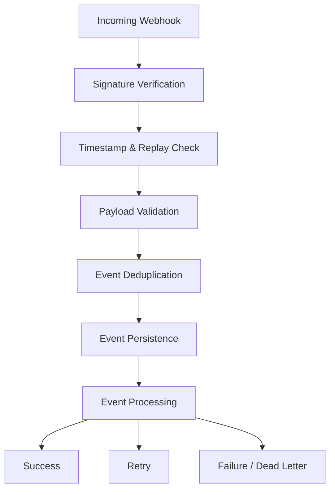
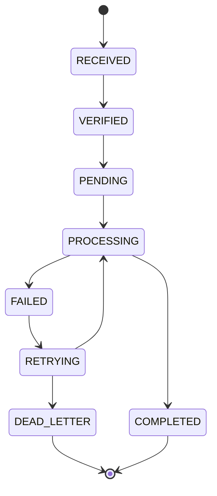

# Node Webhook Engine

A framework-agnostic webhook ingestion and processing engine for Node.js applications.

**Secure. Reliable. Extensible.**

> [!NOTE]
> Node Webhook Engine is fully implemented and tested across all phases, featuring pluggable storage (PostgreSQL, MySQL, Redis, Memory), provider presets (Stripe, GitHub, HMAC), framework integrations (Express, Fastify, NestJS), distributed locking, and telemetry.

## Overview

Webhooks are widely used to communicate events between external services and backend applications.

Payment providers, e-commerce platforms, notification services, and third-party APIs rely on webhooks to notify applications about important events.

However, building a reliable webhook integration involves more than receiving an HTTP request.

Developers must handle:

- Signature verification.
- Duplicate event delivery.
- Replay attack protection.
- Event persistence.
- Processing failures.
- Retry mechanisms.
- Event lifecycle management.
- Observability and logging.

Implementing these features independently for every integration creates repetitive code and increases the risk of security and reliability issues.

**Node Webhook Engine** provides a reusable infrastructure layer for securely receiving, validating, storing, and processing webhook events.

## The Problem

Consider a payment provider sending a webhook after a successful payment.

```json
{
  "id": "evt_12345",
  "type": "payment.completed",
  "data": {
    "orderId": "ORD-1001",
    "amount": 1500,
    "currency": "SAR"
  }
}
```

Several problems can occur:

### 1. Duplicate Events

Webhook providers may deliver the same event multiple times.

Without proper deduplication, your application might process the same payment more than once.

### 2. Invalid Signatures

An attacker could send a fake webhook request pretending to be a trusted provider.

Without signature verification, your application might process fraudulent events.

### 3. Processing Failures

Your database or an external service might become temporarily unavailable while processing an event.

The application needs a reliable way to recover without losing the event.

### 4. Event Ordering

Events may arrive in a different order than they were generated.

For example, a payment capture event might arrive before another related event.

Your application needs explicit rules for handling event dependencies.

### 5. Replay Attacks

A previously valid signed request could be resent by an attacker.

Signature verification alone does not prevent replay attacks. The engine must also validate that the request timestamp falls within an acceptable window and optionally track seen event identifiers to reject redelivered payloads.

## The Solution

Node Webhook Engine provides a unified webhook processing pipeline.



The engine separates webhook infrastructure concerns from application business logic.

> [!IMPORTANT]
> The engine provides **at-least-once** delivery. Event handlers should be **idempotent** — processing the same event twice must produce the same result without side effects.

## Key Features

### Security
- Pluggable signature verification.
- HMAC-based signature support (SHA-256, SHA-512).
- Timestamp validation with configurable tolerance window.
- Replay protection via timestamp bounds and optional nonce tracking.
- Raw request body preservation for accurate signature verification.
- Configurable verification policies.

### Event Management
- Event normalization into a unified model.
- Unique event identification.
- Duplicate detection with atomic storage checks.
- Event lifecycle tracking.
- Event metadata storage.

### Reliability
- Persistent event storage.
- Configurable retry policies.
- Exponential backoff with decorrelated jitter.
- Failed event recovery.
- Processing timeouts.
- Dead Letter handling for exhausted retries.

### Processing
- Custom event handlers.
- Asynchronous event processing.
- Handler registration by event type.
- Processing status management.
- Optional concurrency controls via distributed or advisory locks.

### Observability
- Event emitter for lifecycle hooks (`event.received`, `event.completed`, `event.failed`, `event.deadLetter`).
- Structured logging interface.
- Metrics export hooks (queue depth, processing latency, failure rate).

### Extensibility
- Framework-agnostic core.
- Custom storage adapters.
- Custom signature verifiers.
- Express, Fastify, and NestJS integrations.
- TypeScript-first API.

## Installation

```bash
npm install @ahmedyassin/node-webhook-engine
```

## Quick Start

The following example shows a minimal working setup using the built-in in-memory storage and a no-op verifier.

```typescript
import { WebhookEngine, MemoryStorage, NoOpVerifier } from "@ahmedyassin/node-webhook-engine";

const engine = new WebhookEngine({
    storage: new MemoryStorage(),
    verifier: new NoOpVerifier(),
});

engine.register("payment.completed", async (event) => {
    console.log("Payment completed:", event.data);

    // Execute application business logic.
});

await engine.initialize();
```

> [!WARNING]
> `MemoryStorage` and `NoOpVerifier` are intended for development and testing only. In production, use a persistent storage adapter and a real signature verifier.

### Handling HTTP Requests

The engine does not bind to any HTTP framework directly. Use an integration or call the engine manually:

**With Express middleware:**

```typescript
import express from "express";
import { createExpressMiddleware } from "node-webhook-engine/integrations/express";

const app = express();

app.post(
    "/webhooks/payments",
    express.raw({ type: "application/json" }),
    createExpressMiddleware(engine, { provider: "payment-provider" })
);

app.listen(3000);
```

**With raw Node.js HTTP:**

```typescript
import http from "node:http";

const server = http.createServer(async (req, res) => {
    if (req.method === "POST" && req.url === "/webhooks/payments") {
        const rawBody = await collectBody(req);

        const result = await engine.ingest({
            headers: req.headers,
            rawBody,
            provider: "payment-provider",
        });

        res.writeHead(result.status).end(JSON.stringify(result.body));
        return;
    }

    res.writeHead(404).end();
});
```

### HTTP Response Codes

The engine (and its framework middleware) uses the following response conventions:

| Status | Meaning |
|---|---|
| `200 OK` | Event accepted and queued for processing. |
| `400 Bad Request` | Malformed payload or missing required fields. |
| `401 Unauthorized` | Signature verification failed. |
| `409 Conflict` | Duplicate event; already received or processed. |
| `422 Unprocessable Entity` | Payload validation failed. |
| `500 Internal Server Error` | Unexpected engine error. |

## Webhook Verification

The engine supports pluggable verification strategies through the `SignatureVerifier` interface.

```typescript
import type { SignatureVerifier, VerificationResult } from "node-webhook-engine";

const verifier: SignatureVerifier = {
    async verify({ headers, rawBody }): Promise<VerificationResult> {
        const signature = headers["x-signature"];
        const timestamp = headers["x-timestamp"];

        // 1. Validate timestamp is within acceptable window.
        // 2. Compute expected signature from rawBody + secret.
        // 3. Compare using timing-safe equality.

        return { verified: true };
    },
};
```

> [!IMPORTANT]
> Signature verification must use the original raw request body. Parsed or re-serialized JSON may differ from the bytes the provider signed.

Different providers use different signature formats and verification rules. The engine ships with an HMAC verifier for common cases:

```typescript
import { HmacVerifier } from "node-webhook-engine";

const verifier = new HmacVerifier({
    secret: process.env.WEBHOOK_SECRET,
    algorithm: "sha256",                    // "sha256" | "sha512"
    signatureHeader: "x-webhook-signature",
    timestampHeader: "x-webhook-timestamp",
    maxTimestampAge: 300_000,               // 5 minutes in milliseconds
});
```

## Replay Protection

Replay protection prevents attackers from resending a previously valid signed request.

The engine applies two layers:

1. **Timestamp validation** — Requests with a timestamp older than `maxTimestampAge` (default: 5 minutes) are rejected immediately.
2. **Nonce / event ID tracking** — Optionally, seen event identifiers are stored and checked to reject exact re-deliveries within the deduplication window.

Together with signature verification, this ensures that even a captured valid request cannot be replayed after the timestamp window expires.

## Event Deduplication

Each incoming event has a stable unique identifier.

```typescript
{
    eventId: "evt_12345",
    provider: "payment-provider",
    type: "payment.completed"
}
```

Before processing, the engine checks whether the event has already been accepted or processed.

The storage layer enforces uniqueness atomically to prevent concurrent duplicate processing using database-level unique constraints or compare-and-set operations.

## Retry Mechanism

Failed events are eligible for controlled retry with exponential backoff.

```typescript
const retryPolicy = {
    maxAttempts: 5,
    initialDelay: 1000,          // 1 second
    maxDelay: 30000,             // 30 seconds
    backoffMultiplier: 2,
    jitter: "decorrelated",      // "none" | "full" | "decorrelated"
};
```

> [!TIP]
> Decorrelated jitter (the default) provides better spread across retrying clients than full jitter. See the [AWS Architecture Blog on Exponential Backoff and Jitter](https://aws.amazon.com/blogs/architecture/exponential-backoff-and-jitter/) for background.

The engine distinguishes between error types using the `WebhookError` base class:

```typescript
import { RetryableError, PermanentError } from "node-webhook-engine";

engine.register("payment.completed", async (event) => {
    try {
        await processPayment(event.data);
    } catch (err) {
        if (isTemporary(err)) {
            throw new RetryableError("Database unavailable", { cause: err });
        }
        throw new PermanentError("Invalid payment data", { cause: err });
    }
});
```

| Error Type | Behavior |
|---|---|
| `RetryableError` | Event moves to `RETRYING`, scheduled for next attempt. |
| `PermanentError` | Event moves directly to `DEAD_LETTER`. |
| Untyped / unknown error | Treated as retryable up to `maxAttempts`. |

Retry attempts are persisted so that application restarts do not lose retry state.

## Event Lifecycle

An event moves through the following states:



| State | Description |
|---|---|
| `RECEIVED` | Raw webhook payload received. |
| `VERIFIED` | Signature and timestamp validated. |
| `PENDING` | Deduplicated and persisted; awaiting processing. |
| `PROCESSING` | Handler is executing. |
| `COMPLETED` | Handler finished successfully. |
| `FAILED` | Handler threw an error. |
| `RETRYING` | Scheduled for another processing attempt. |
| `DEAD_LETTER` | All retry attempts exhausted or a permanent error occurred. |

State transitions are validated — the engine rejects invalid sequences (e.g., `COMPLETED → RETRYING`).

## API Reference

### `WebhookEngine`

```typescript
interface WebhookEngineOptions {
    storage: StorageAdapter;
    verifier: SignatureVerifier;
    retryPolicy?: RetryPolicy;
    maxTimestampAge?: number;        // milliseconds, default: 300_000
    processingTimeout?: number;      // milliseconds, default: 30_000
    concurrency?: number;            // max concurrent handlers, default: 10
}

class WebhookEngine {
    constructor(options: WebhookEngineOptions);

    initialize(): Promise<void>;
    shutdown(): Promise<void>;

    register(eventType: string, handler: EventHandler): void;
    unregister(eventType: string): void;

    ingest(request: IngestRequest): Promise<IngestResult>;

    retryDeadLetters(filter?: DeadLetterFilter): Promise<number>;

    on(event: EngineEvent, listener: EngineEventListener): void;
    off(event: EngineEvent, listener: EngineEventListener): void;
}
```

### `StorageAdapter`

```typescript
interface StorageAdapter {
    initialize(): Promise<void>;
    shutdown(): Promise<void>;

    storeEvent(event: WebhookEvent): Promise<void>;          // Must enforce unique eventId+provider
    findEvent(eventId: string, provider: string): Promise<WebhookEvent | null>;
    updateEventStatus(eventId: string, provider: string, status: EventStatus): Promise<void>;

    claimEvent(eventId: string, provider: string): Promise<boolean>;   // Atomic processing lock
    releaseEvent(eventId: string, provider: string): Promise<void>;

    getRetryableEvents(): Promise<WebhookEvent[]>;
    getDeadLetterEvents(filter?: DeadLetterFilter): Promise<WebhookEvent[]>;
}
```

### `SignatureVerifier`

```typescript
interface SignatureVerifier {
    verify(context: VerificationContext): Promise<VerificationResult>;
}

interface VerificationContext {
    headers: Record<string, string | string[] | undefined>;
    rawBody: Buffer;
}

interface VerificationResult {
    verified: boolean;
    reason?: string;
}
```

### `EventHandler`

```typescript
type EventHandler = (event: WebhookEvent) => Promise<void>;

interface WebhookEvent {
    eventId: string;
    provider: string;
    type: string;
    data: unknown;
    headers: Record<string, string | string[] | undefined>;
    receivedAt: Date;
    status: EventStatus;
    attempts: number;
    lastAttemptAt?: Date;
    lastError?: string;
    metadata?: Record<string, unknown>;
}
```

## Configuration Reference

| Option | Type | Default | Description |
|---|---|---|---|
| `storage` | `StorageAdapter` | *required* | Persistent event storage implementation. |
| `verifier` | `SignatureVerifier` | *required* | Signature verification strategy. |
| `retryPolicy.maxAttempts` | `number` | `5` | Maximum retry attempts before dead-lettering. |
| `retryPolicy.initialDelay` | `number` | `1000` | Initial delay in milliseconds before first retry. |
| `retryPolicy.maxDelay` | `number` | `30000` | Maximum delay cap in milliseconds. |
| `retryPolicy.backoffMultiplier` | `number` | `2` | Multiplier applied to delay after each attempt. |
| `retryPolicy.jitter` | `string` | `"decorrelated"` | Jitter strategy: `"none"`, `"full"`, or `"decorrelated"`. |
| `maxTimestampAge` | `number` | `300000` | Maximum age of webhook timestamp in ms (replay protection). |
| `processingTimeout` | `number` | `30000` | Handler execution timeout in milliseconds. |
| `concurrency` | `number` | `10` | Maximum number of events processed concurrently. |

## Storage Architecture

The engine does not require a specific database.

Developers implement the `StorageAdapter` interface for their chosen backend.

| Storage | Purpose |
|---|---|
| PostgreSQL | Persistent event storage with advisory locks. |
| MySQL | Relational event storage. |
| Redis | Distributed locks and coordination. |
| MongoDB | Document-based event storage. |
| In-Memory | Development and testing only. |
| Custom Adapter | Application-specific storage. |

A production storage implementation must support atomic deduplication (unique constraints), processing claims (locking), and safe concurrency control.

## Framework Integrations

The core engine remains independent of HTTP frameworks.

Optional integration packages provide framework-specific request handling.

| Framework | Integration | Package |
|---|---|---|
| Express | Middleware | `node-webhook-engine/integrations/express` |
| Fastify | Route plugin | `node-webhook-engine/integrations/fastify` |
| NestJS | Module and controller | `node-webhook-engine/integrations/nestjs` |
| Native Node.js | HTTP handler | Built-in via `engine.ingest()` |

## Architecture

```text
node-webhook-engine/
│
├── src/
│   ├── core/
│   │   ├── engine.ts
│   │   ├── event.ts
│   │   ├── event-state.ts
│   │   ├── errors.ts
│   │   └── types.ts
│   │
│   ├── security/
│   │   ├── verifier.ts
│   │   ├── hmac-verifier.ts
│   │   ├── signature.ts
│   │   └── replay-protection.ts
│   │
│   ├── processing/
│   │   ├── processor.ts
│   │   ├── handler-registry.ts
│   │   └── retry-policy.ts
│   │
│   ├── storage/
│   │   ├── storage.interface.ts
│   │   ├── memory-storage.ts
│   │   └── adapters/
│   │
│   └── integrations/
│       ├── express/
│       ├── fastify/
│       └── nestjs/
│
├── tests/
├── examples/
├── package.json
├── CHANGELOG.md
└── README.md
```

## Design Principles

- Framework independence.
- Secure-by-default verification.
- At-least-once delivery with idempotent handlers.
- Persistent event processing.
- Reliable duplicate prevention.
- Explicit event lifecycle management.
- Pluggable storage architecture.
- Configurable retry policies.
- Strong TypeScript support.
- Minimal runtime dependencies.

## Requirements

- Node.js 20 or later.
- TypeScript 5.0+ recommended.
- A persistent storage adapter for production use.

## Roadmap

### Phase 1 – Core & Baseline Security
- [x] Webhook event model and types.
- [x] Event handler registry.
- [x] Signature verifier interface.
- [x] HMAC signature verifier.
- [x] Timestamp validation.
- [x] Event storage interface.
- [x] In-memory storage adapter.
- [x] Event deduplication.
- [x] Basic processing pipeline.
- [x] Error type hierarchy (`RetryableError`, `PermanentError`).

### Phase 2 – Reliability
- [x] Persistent processing.
- [x] Retry mechanism with exponential backoff.
- [x] Decorrelated jitter.
- [x] Dead Letter handling.
- [x] Processing locks (`claimEvent` / `releaseEvent`).
- [x] Concurrency management.
- [x] Processing timeouts.

### Phase 3 – Advanced Security
- [x] Replay protection with nonce tracking.
- [x] Raw body preservation utilities (`captureRawBody`, `getOrReadRawBody`).
- [x] Provider signature presets (`GitHubVerifier`, `StripeVerifier`).
- [x] Security test suite.

### Phase 4 – Integrations
- [x] Express middleware (`createExpressMiddleware`).
- [x] Fastify route plugin (`createFastifyPlugin`).
- [x] NestJS module & service (`WebhookService`, `createWebhookProviders`).
- [x] PostgreSQL adapter (`PostgresStorageAdapter`).
- [x] MySQL adapter (`MysqlStorageAdapter`).
- [x] Redis adapter (locks and coordination: `RedisStorageAdapter`, `RedisLockManager`).

### Phase 5 – Developer Experience
- [x] Event inspection and query API (`getEvent`, `listEvents`).
- [x] Dead letter replay API (`retryDeadLetters`).
- [x] Structured logging interface (`Logger`).
- [x] Event emitter lifecycle hooks.
- [x] Metrics export (`MetricsCollector`).
- [x] Performance benchmarks (`npm run bench`).
- [x] Complete API documentation.

## Testing

The project includes:

- Unit tests for each module.
- Integration tests for the full pipeline.
- Concurrent duplicate delivery tests.
- Invalid signature rejection tests.
- Replay attack prevention tests.
- Retry and recovery tests.
- Storage failure and crash recovery tests.
- Event lifecycle state machine tests.

## Contributing

Contributions, bug reports, and feature requests are welcome.

Please open an issue before submitting major changes.

## License

MIT License.
